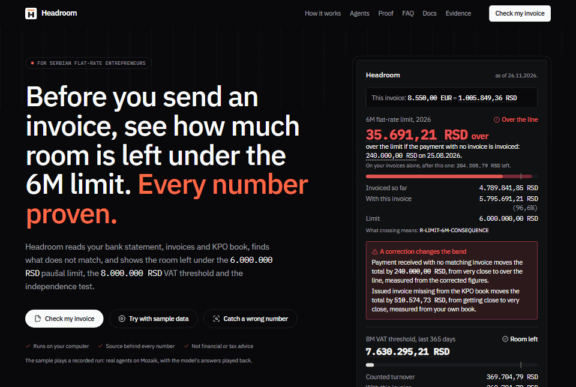
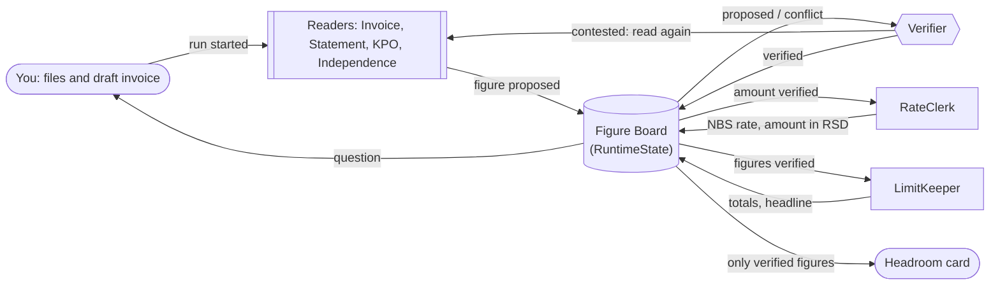

# Headroom

**Before a Serbian paušalac sends an invoice, Headroom shows how much room is left under the 6M limit, and proves every number.**

**Not financial or tax advice · Bundled samples are synthetic**

**[Live demo](https://headroom-umber.vercel.app)** (recorded sample, no key, no uploads; the server sleeps when idle, so the first request can take up to a minute) · Built for the JigJoy Black Friday AI Hackathon, track Agents in Finance, on Mozaik (`@mozaik-ai/core` 6.0.0)



_The offline sample: a real model's answers replayed through real Mozaik loops. On the site: [Agents](https://headroom-umber.vercel.app/agents) · [Proof](https://headroom-umber.vercel.app/proof) · [Evidence](https://headroom-umber.vercel.app/evidence) · [Docs](https://headroom-umber.vercel.app/docs)._

## The problem

A _paušalac_ is a Serbian sole proprietor taxed at a flat rate, who keeps only a simple income book (the KPO book). That status has hard edges:

- **6,000,000 RSD a year.** Above it the entrepreneur has to [keep full business books](https://biznis.rs/vesti/srbija/limit-od-sest-miliona-dinara-koci-razvoj-preduzetnika/), from 1 July or from the next 1 January. The limit has [not changed since 2013](https://biznis.rs/vesti/srbija/limit-od-sest-miliona-dinara-koci-razvoj-preduzetnika/).
- **8,000,000 RSD in 12 months.** Above it a [VAT registration is due within five days](https://www.purs.gov.rs/upload/media/2025/6/30/759981/Tax_bulletins_for_natural_persons_who_are_self_-_employed.pdf).
- **The independence test.** If five of nine criteria are met for a client, income from that client [may be taxed as other income](https://biznis.rs/preduzetnik/preduzetnici-na-proveri-poslovne-samostalnosti/): 20% tax plus 25.5% pension contributions.

Whether the invoice you are **about to send** crosses one of these lines depends on every invoice before it, the official exchange rate of each foreign one, and money that landed in the bank **without** an invoice. A total of issued invoices does not show that. Headroom answers from what the bank statement, the invoices and the book say **together**, including where they disagree, before the next invoice is sent.

**Who it is for:** a Belgrade IT freelancer on paušal with two or three clients, mostly foreign and invoiced in euros, late in November, about to invoice their biggest client.

## What Headroom does

You give it your bank statement, invoice PDFs, KPO book and the invoice you are about to send. Seven agents read and check them at once, and it answers before you press send:

- **How much room is left** under 6M and 8M, with and without this invoice, and the independence test per client.
- **What moves the answer:** payments with no invoice (counted in the headline), invoices missing from your book, wrong dates, amounts or exchange rates, duplicates, and numbering gaps.
- **A corrected KPO book** with a correction log, as CSV or PDF.
- **Every number opens its source:** the invoice line, the bank row, the NBS rate response or the rule.

It never says "room left" from part of your files: until every input is verified the card reads **Incomplete**, and a failed agent ends the run `degraded` or `failed`. It does not calculate tax or advise what to do.

## What already exists

Checked on 27 November 2026 from public pages, not by using the products.

| Product                                                                                                                    | What its page says                                                                                                                        | Not mentioned on the page read                                                      |
| -------------------------------------------------------------------------------------------------------------------------- | ----------------------------------------------------------------------------------------------------------------------------------------- | ----------------------------------------------------------------------------------- |
| [Pausal.rs](https://pausal.rs/en/pausal-application/)                                                                      | invoices, automatic KPO book, 6M and 8M tracking with warnings; links to a [paid online independence test](https://testsamostalnosti.rs/) | matching a bank statement against invoices; checking an invoice before it is issued |
| [Paušal Box](https://pausalbox.rs/)                                                                                        | imports bank statements and links payments to invoices; KPO book; limit warnings at 80% and 90%                                           | the independence test; checking an invoice before it is issued                      |
| [Minimax](https://rs-minimax.knowledgeowl.com/help/upozorenje-za-ulazak-pausalaca-u-knjigase-ili-za-ulazak-u-sistem-pdv-a) | accounting program that warns at 90% of the limit, by supply date                                                                         | the independence test (this help article covers the warnings only)                  |

Headroom is not an invoicing app. It takes the files you already have, from any tool, answers about the invoice **before** you issue it, shows where the statement, invoices and book disagree, and opens the source behind each number.

## Run it (no key needed)

Requires Node 22.12 or later.

```
git clone https://github.com/TheWeirdDee/headroom.git && cd headroom
npm run setup
npm run start:offline        # then open http://localhost:4317
```

Click **Try with sample data**, or **Catch a wrong number**. The run takes a few seconds and ends `awaiting_user`: six questions about the independence test are yours to answer. Offline mode is real Mozaik execution with recorded model answers, not a video; a request that was not recorded stops with `REPLAY_MISS` rather than inventing an answer.

Four commands that check the claims below, each exiting non-zero if the claim is false:

```
npm run benchmark      # concurrent against one model request at a time
npm run prove          # several agents had model requests outstanding at the same time
npm run demo:catch     # the Verifier rejects a misread amount and the total stays right
npm test               # includes the keyless run: 65 loops, none failed, all 5 planted errors
```

## Agents on Mozaik

A run is one Mozaik runtime that nine participants join. **Nothing calls an agent:** each acts when an event satisfies one of its own `SituationSpecification`s, writes to the shared board, and the others react. One event from the user starts the run. There is no other runtime and no orchestrator.



| Participant                                                     | Reacts when (its specifications, `src/agents/situations.ts`)                                                                                                     | Model                              |
| --------------------------------------------------------------- | ---------------------------------------------------------------------------------------------------------------------------------------------------------------- | ---------------------------------- |
| [InvoiceReader](src/agents/invoice-reader/agent.ts)             | the run starts; **one of its own figures is contested** (it reads the document again with the Verifier's note)                                                   | one loop per invoice               |
| [StatementReader](src/agents/statement-reader/agent.ts)         | the run starts; a payment, link or invoice figure is settled; one of its figures is contested; the InvoiceReader finishes (then it looks for unmatched payments) | one loop per 25 bank rows          |
| [KpoReader](src/agents/kpo-reader/agent.ts)                     | the run starts                                                                                                                                                   | one loop per 25 book rows          |
| [IndependenceChecker](src/agents/independence-checker/agent.ts) | the run starts; invoice figures change; one of its figures is contested; the user answers its question                                                           | one loop per client contract       |
| [Verifier](src/agents/verifier/agent.ts)                        | someone proposes a figure; two figures conflict; an input settles; the user answers its question                                                                 | one loop per judgement it re-reads |
| [RateClerk](src/agents/rate-clerk/agent.ts)                     | an invoice's amount, currency or date is verified; someone else claims an amount in RSD; a rate is needed                                                        | none: rules in code                |
| [LimitKeeper](src/agents/limit-keeper/agent.ts)                 | figures are verified or replaced; a reader finishes; the draft changes                                                                                           | none: rules in code                |
| [Human](src/agents/human.ts)                                    | the run starts (posts the invoice about to be sent); answers and changes come from the user                                                                      | the user                           |
| [Transcript](src/agents/observer.ts)                            | every event (the only participant that does)                                                                                                                     | none                               |

| Mozaik                               | What it does here                                                                                                                                                                                                                           | Where                                                                                  |
| ------------------------------------ | ------------------------------------------------------------------------------------------------------------------------------------------------------------------------------------------------------------------------------------------- | -------------------------------------------------------------------------------------- |
| `createAgent`, `createHuman`, `join` | every participant above; each model agent holds its prompt as its Mozaik instruction                                                                                                                                                        | `src/agents/*/agent.ts`                                                                |
| `SituationSpecification`, `.and()`   | all routing, for example `EventIs('hr.figure.contested').and(new AboutMyFigure())`                                                                                                                                                          | `src/agents/situations.ts`                                                             |
| `RuntimeState`                       | the Figure Board _is_ the runtime state every participant reads and writes                                                                                                                                                                  | [state.ts](src/runtime/state.ts)                                                       |
| `sendEvent`, `SemanticEvent`         | agents talk only through events: figure proposed, contested, verified, questions, rate needed                                                                                                                                               | [runtime.ts](src/runtime/mozaik/runtime.ts)                                            |
| `runLoop`                            | every model request, with a fresh `ModelContext`; an agent hears its answer through its own specification on `model.answer`                                                                                                                 | [runtime.ts](src/runtime/mozaik/runtime.ts)                                            |
| `InterceptionHandler`                | the Verifier sits inside the four reading agents' loops and refuses a submission that reports a value without the text it was read from, before the tool runs. A test makes it fire; in the recorded and live runs so far no model did this | [gate.ts](src/agents/verifier/gate.ts)                                                 |
| custom `InferenceRunner`             | timeouts, retries, rate-limit pacing, recording and replay                                                                                                                                                                                  | [runtime.ts](src/runtime/mozaik/runtime.ts), [recordings.ts](src/engine/recordings.ts) |

Mozaik calls a processor without awaiting it, so each participant's processor puts the event in that participant's own [queue](src/runtime/inbox.ts): one agent handles one event at a time, different agents run side by side. `runLoop` reports no failure of its own, so a failed request is turned into a failed loop, which makes the run `degraded` or `failed`. A [test](test/engine/mozaik.e2e.test.ts) fails if an agent stops being a participant with specifications of its own.

**Checks between agents.** Readers claim the same keys: the InvoiceReader and the KpoReader both state an invoice's date and RSD amount, and the RateClerk re-derives the amount from the NBS rate. Agreement corroborates; disagreement is a conflict that the Verifier settles by checking both against their sources and, if both hold, by source authority (invoice document over KPO row for invoice facts, statement row over document for payment facts). The losing figure becomes the discrepancy the user sees.

Found in Mozaik while building this and reported upstream with a reproduction: its Gemini mapper drops `thoughtSignature`, so the request after a tool call fails ([jigjoy-ai/mozaik-network#160](https://github.com/jigjoy-ai/mozaik-network/issues/160); workaround in [gemini-signatures.ts](src/runtime/mozaik/gemini-signatures.ts)).

## Proof it is concurrent

**The same agents reach the verdict 7.9 times sooner when they run together.**

```
npm run benchmark           # no key, no network, about 3 minutes
```

The sample is run twice on the same code with the same recorded model answers. Only one thing differs: in the second run a single model request may be in flight at a time. Each request takes 1.4 s, the median of the 12 recorded requests that did not wait for a rate limit. Measured 2026-11-27:

|                             | Concurrent | One request at a time |
| --------------------------- | ---------- | --------------------- |
| Time to a complete verdict  | **14.8 s** | **117.5 s**           |
| Model requests              | 83         | 83                    |
| Agent loops (failed)        | 65 (0)     | 65 (0)                |
| Peak requests at once       | 15         | 1                     |
| Peak agents waiting at once | 5          | 1                     |
| Figures verified            | 217        | 217                   |
| 6M and 8M totals            | identical  | identical             |

The command exits 1 if the totals differ, a loop fails or the gain falls below 2 times. A free tier that allows 15 requests a minute hides the gain: there the rate limit sets the pace.

### Requests really in flight together

```
npm run prove               # no key, no network
npm run prove -- --live     # the same measurement on provider requests (uses your quota)
```

The command runs the `p07` sample on Mozaik and records, for every model request, the moment it is sent (after any wait for a rate limit) and the moment it is answered. It prints when each agent was waiting on a model, and **exits 1** unless at least three different agents and four requests were outstanding at the same instant with no failed loop. CI runs it on every push. Without a key the answers come from the recording after a short pause, so it proves that Mozaik runs the agents' loops side by side without blocking; `--live` measures the provider.

One run without a key, on 27 Nov 2026 (times differ a little from run to run):

```
  independence-checker 3333335333331...............................................  6 requests
  kpo-reader           1111112111111...............................................  2 requests
  statement-reader     11111111111111..............................................  2 requests
  invoice-reader       444444445644446644445544446533335433444211111111211111111111  26 requests
  verifier             .....366666+66666+666668966667+6666697666786977797764441....  47 requests

Peak requests outstanding at once   15
Peak agents waiting on a model      5 (independence-checker, invoice-reader, kpo-reader, statement-reader, verifier)
Time with 2+ agents waiting at once 2.53 s of 2.74 s with any request
Sum of request times                23.15 s (one after another would take this long)
PASS: the agents asked their models at the same time.
```

The run screen draws every loop as a bar on a timeline. A loop there is open from its start to its answer, which on a free tier includes waiting for the quota, so "loops open at once" is not the same as requests in flight; use `npm run prove` for the latter.

A live run of the current code with `gemini-3.5-flash-lite` on a small sample had up to 10 requests and all 5 model agents outstanding at once ([output](eval/live-current/RESULTS.md)).

## Watch the Verifier catch a wrong number

```
npm run demo:catch          # or the "Catch a wrong number" button on the landing page
```

This replays the recorded sample with **one fault injected on purpose**: the first reading of invoice 2026-006 is altered from 3500.00 to 5300.00 EUR before it reaches the InvoiceReader. The model did not make that mistake, and every screen and report of such a run says so. What follows is the pipeline's own work:

```
invoice-reader proposed 5300 EUR -> CONTESTED: excerpt "3.500,00 EUR" does not show the amount 5300
invoice-reader proposed 3500 EUR -> VERIFIED
```

The Verifier rejects the figure, the InvoiceReader reads the document again with the Verifier's note (answered with what the model really answered), and the 6M total equals that of the replay without the fault (a test also checks it against the ground truth). The command exits 1 otherwise, and CI runs it. This particular catch is a code check: the cited line does not hold the number.

## Every number has a source

Every figure carries `SourceRef`s: a document page and line range with the excerpt and its SHA-256, a statement or KPO row with its raw line and hash, an NBS response with its hash and JSON path, a contract field, a rule, a user answer, or the input figures it was derived from. The Verifier checks each proposed figure before it counts. A failed check contests the figure with a reason code; after three contests on one key the question goes to you. Only verified figures reach the headroom card, the card gives no verdict until every input is verified, and the run report counts figures shown without a source (it must be 0).

Most of the checking is code. The Verifier's model is used only for judgements, and it sees the claimed value and the excerpt, never the reader's reasoning:

| What is checked                                                             | How   | What that check can catch                                                                                                      |
| --------------------------------------------------------------------------- | ----- | ------------------------------------------------------------------------------------------------------------------------------ |
| The source exists and its hash matches                                      | code  | invented or altered citations                                                                                                  |
| Invoice date, amount, currency, number, client against the cited text       | code  | a value the text does not show; a due or supply date given as the issue date; a unit price, subtotal or tax given as the total |
| Amounts, dates and names from bank and KPO rows                             | code  | consistency only: the same parser read the row                                                                                 |
| Conversions, totals, shares and statuses                                    | code  | any difference, to the cent, from recomputing them from the cited input figures                                                |
| NBS rate                                                                    | code  | a rate that differs from the recorded response                                                                                 |
| Client country, product or service, kind of bank payment, contract criteria | model | a judgement a second reading does not support                                                                                  |

The model never re-reads an amount or a date: those are checked by code against the text. A wrong value that the text also shows under no recognised label could pass.

## Results

Measured on synthetic profiles we designed, with planted errors. Conditions, every table and what has **not** been measured: [docs/evaluation.md](docs/evaluation.md).

| Run                                                              | Planted errors found  | Findings not planted            | Totals equal to the truth |
| ---------------------------------------------------------------- | --------------------- | ------------------------------- | ------------------------- |
| Gemini `gemini-3.5-flash-lite`, 5 profiles, 7 runs               | 19 / 19 (all 9 types) | 0                               | 7 / 7                     |
| Groq `gpt-oss-120b`, 2 profiles, 2 runs                          | 3 / 3                 | 2 (a Headroom bug, fixed since) | 2 / 2                     |
| Current code, live, 1 small profile, 1 run                       | 3 / 3                 | 0                               | not measured              |
| Current code, deterministic test model, 14 profiles, 2 runs each | 80 / 80               | 0                               | 28 / 28                   |

The real-model runs on the 14-profile set were made before later changes to the pipeline and have not been repeated. The last row measures the pipeline (rules, checks, conflicts, totals), not how well a model reads.

## Use it on your own files

```
cp .env.example .env         # add your Gemini key (GEMINI_API_KEY, free at aistudio.google.com)
npm start                    # open http://localhost:4317
```

Drop in your bank statement CSV, invoice PDFs (with a text layer) and KPO book, map the columns if asked, enter your clients and the invoice you are about to send, and click **Check this invoice**.

A client list file (`clients.json`) is optional and fills the client form. Its `contract` fields are the only way contract wording reaches the independence test; without them those criteria stay unknown. Each field is a sentence from or about your contract ([full example](data/profiles/p07/clients.json)):

```json
[
  {
    "id": "acme",
    "name": "Acme GmbH",
    "country": "DE",
    "isBusiness": true,
    "vatId": "DE123456789",
    "contract": {
      "workingHoursSetByClient": "No: the contractor sets own hours.",
      "workplaceSetByClient": "No: work is done remotely.",
      "trainingByClient": "No: no training by the client.",
      "equipmentOrManagementByClient": "No: the contractor uses own equipment.",
      "clientLineOfBusinessWithoutRiskClause": "No: the contractor bears delivery risk.",
      "nonCompeteClause": "No: no restriction on other clients."
    }
  }
]
```

- The default model is `gemini-3.5-flash-lite`, which has a free tier. Requests are paced (14 a minute, under the free tier's 15; `HEADROOM_MAX_RPM`), so a year of about a dozen invoices needs some 85 requests and about 6 minutes, out of the free tier's 500 requests a day.
- Groq models work as `groq/<model>` with `GROQ_API_KEY` (`HEADROOM_MODEL_READER`, `HEADROOM_MODEL_VERIFIER`); [groq.ts](src/runtime/mozaik/groq.ts) points Mozaik's chat-completions endpoint at Groq.
- CI runs the tests on Linux and Windows. macOS is not tested.

## What you will see

1. The landing page: type your next invoice amount and get the answer, or read the problem with its sources, try the sample or catch a wrong number. Agents, Proof, Evidence and Docs each have a page of their own.
2. Intake: your files, a column mapper for CSV layouts it does not recognise, your clients and the draft invoice.
3. Seven agent lanes start at once, each with a plain "doing now" line. What the Verifier rejects is listed above them.
4. Figures appear on the board as proposed, then turn verified, contested or needs-you as the Verifier checks each against its source.
5. Conflicts are visible: the KPO book says one date or amount, the invoice says another, and the source decides.
6. The headroom card says **Incomplete**, with the reasons, until every input is verified; a failed agent loop keeps it that way and ends the run `degraded` or `failed`. Then it gives the verdict, counting client payments that have no invoice, and says which discrepancy moves the band.
7. Discrepancies and questions collect below the board. Answering a question re-opens the run and the dependent agents recompute.
8. The KPO book tab shows the corrected book in the official layout with a correction log, exportable as CSV or PDF.
9. The Evidence tab shows the evaluation results, misses included.

## Your data

- Uploaded files stay on your machine, in `uploads/<id>/`. **Delete my files** on the intake page removes them.
- In live mode, the extracted text of your invoices, statement rows and KPO rows is sent to the model provider (Google Gemini by default) to be read. Nothing else leaves the machine: arithmetic, rules and totals run locally.
- NBS middle rates come from the public Kurs API (`kurs.resenje.org`); only currency and date are sent.
- Runs on your files are never recorded. Only bundled synthetic samples can be recorded for offline replay.

## Architecture

```
Browser (React + Vite): landing, intake + column mapper, run screen, KPO book, evidence, docs
        |  REST + SSE (/api/runs/:id/stream, resumes with Last-Event-ID)
Node 22 backend (Fastify)
  Run engine: one Mozaik runtime per run
  Participants      src/agents/        7 agents, the user, the transcript
  Shared state      src/runtime/state.ts + packages/claims   (the Figure Board)
  Mozaik runtime    src/runtime/mozaik/   events, loops, inference runner, Groq and Gemini fixes
  Rules             rules/*.json + src/domain/     pure TypeScript, exact decimals, no model
  Inputs, exports   src/inputs/, src/exporters/    PDF text, CSV mapping, KPO CSV and PDF
  Recordings        runs/demo-p07 + src/engine/recordings.ts
        |                                     |
  Model provider (through Mozaik)     Kurs API (NBS middle rates)
```

- **InvoiceReader** reads invoice PDFs and proposes number, dates, amount, currency, client and kind, each with its line excerpt.
- **StatementReader** classifies incoming statement rows and links payments to invoices.
- **KpoReader** reads the user's KPO book and claims each row against the invoices.
- **RateClerk** fetches the NBS middle rate for each foreign invoice date and converts to RSD.
- **LimitKeeper** totals verified turnover for the 6M limit and the 8M VAT window, with and without the draft, and explains band crossings.
- **IndependenceChecker** evaluates the nine criteria per client, including the income share of criterion 6.
- **Verifier** checks every figure against its source before it counts.

The event types are defined in `src/events/schemas.ts`.

## Tax rules used

Headroom applies the rules below; each card number links to the ones it used. **Assumption [VERIFY]** means no official source confirms it, and the app marks it wherever it affects a number.

<details>
<summary>All rules, with sources and status</summary>

| Rule                         | Statement                                                                                                                                                                                                                                                                                                                                                                                                   | Source                                                                                                                                                                                                                            | Status              |
| ---------------------------- | ----------------------------------------------------------------------------------------------------------------------------------------------------------------------------------------------------------------------------------------------------------------------------------------------------------------------------------------------------------------------------------------------------------- | --------------------------------------------------------------------------------------------------------------------------------------------------------------------------------------------------------------------------------- | ------------------- |
| `R-FX`                       | For bookkeeping, the official NBS middle rate of the dinar applies.                                                                                                                                                                                                                                                                                                                                         | [Zakon o deviznom poslovanju](https://www.paragraf.rs/propisi/zakon_o_deviznom_poslovanju.html)                                                                                                                                   | Sourced             |
| `R-FX-DATE`                  | A foreign-currency invoice is converted at the NBS middle rate on its issue date.                                                                                                                                                                                                                                                                                                                           | [Unija: KPO knjiga](https://unija.com/sr/kpo-knjiga/)                                                                                                                                                                             | Assumption [VERIFY] |
| `R-FX-NONPUB`                | On weekends and holidays, when NBS publishes no new rate, the most recent published rate is used. Both the requested date and the rate date are shown.                                                                                                                                                                                                                                                      | [Kurs API documentation](https://kurs.resenje.org/doc/)                                                                                                                                                                           | Assumption [VERIFY] |
| `R-FX-ROUNDING`              | The RSD amount is rounded to two decimals, half up.                                                                                                                                                                                                                                                                                                                                                         | [Zakon o deviznom poslovanju](https://www.paragraf.rs/propisi/zakon_o_deviznom_poslovanju.html)                                                                                                                                   | Assumption [VERIFY] |
| `R-INDEP`                    | Income from a client is treated as "other income" instead of self-employment income if, for that client, at least five of the nine criteria are met (or it could be concluded at the start of the work that five would be met and they later were). Evaluated per client.                                                                                                                                   | [Zakon o porezu na dohodak građana](https://www.paragraf.rs/propisi/zakon_o_porezu_na_dohodak_gradjana.html)                                                                                                                      | Sourced             |
| `R-INDEP-EXEMPT`             | The test does not apply to an entrepreneur who, under the law governing their activity, cannot be employed by the client (for example a lawyer).                                                                                                                                                                                                                                                            | [Zakon o porezu na dohodak građana](https://www.paragraf.rs/propisi/zakon_o_porezu_na_dohodak_gradjana.html)                                                                                                                      | Sourced             |
| `R-INDEP-C6-WINDOWS`         | Every 12-calendar-month period that starts or ends in the tax year is checked; the card shows the highest share and its period.                                                                                                                                                                                                                                                                             | [Zakon o porezu na dohodak građana](https://www.paragraf.rs/propisi/zakon_o_porezu_na_dohodak_gradjana.html)                                                                                                                      | Sourced             |
| `R-INDEP-C6-HORIZON`         | Headroom evaluates the 12-month periods that have ended by the month being checked (the as-of month, or the draft invoice month for the with-draft share) and that your files cover, plus always the 12 months up to that month. A period reaching into the future, or mostly before your files start, holds only part of its income, so its share would mislead. Another period may still reach 70% later. | [Zakon o porezu na dohodak građana](https://www.paragraf.rs/propisi/zakon_o_porezu_na_dohodak_gradjana.html)                                                                                                                      | Headroom convention |
| `R-INDEP-C6-BASIS`           | Income is counted from issued invoices in RSD by issue date. The law says "ostvarenih prihoda" (income earned) and does not say invoiced or received.                                                                                                                                                                                                                                                       | [Zakon o porezu na dohodak građana](https://www.paragraf.rs/propisi/zakon_o_porezu_na_dohodak_gradjana.html)                                                                                                                      | Assumption [VERIFY] |
| `R-INDEP-CONSEQUENCE`        | Income from that client may be taxed as other income: 20% tax plus 25.5% pension and disability (PIO) contributions, with no standardised expenses deducted. Headroom does not calculate any amount.                                                                                                                                                                                                        | [Biznis.rs](https://biznis.rs/preduzetnik/preduzetnici-na-proveri-poslovne-samostalnosti/)                                                                                                                                        | Sourced             |
| `R-INDEP-WHO-FILES`          | If you earn this income from or in another country and the payer does not calculate and pay the tax, you must calculate and pay it yourself.                                                                                                                                                                                                                                                                | [Zakon o porezu na dohodak građana](https://www.paragraf.rs/propisi/zakon_o_porezu_na_dohodak_gradjana.html)                                                                                                                      | Sourced             |
| `R-KPO`                      | A paušal entrepreneur keeps only the KPO book, recording income from products sold and services provided; every issued invoice is entered, paid or not.                                                                                                                                                                                                                                                     | [Zakon o porezu na dohodak građana](https://www.paragraf.rs/propisi/zakon_o_porezu_na_dohodak_gradjana.html)                                                                                                                      | Sourced             |
| `R-KPO-LAYOUT`               | Columns: 1 row number; 2 date and description; 3 income from products; 4 income from services; 5 total (3 + 4). Header: PIB, taxpayer name, business name, address, taxpayer code, activity code.                                                                                                                                                                                                           | [Pravilnik o poslovnim knjigama i iskazivanju finansijskog rezultata po sistemu prostog knjigovodstva](https://www.paragraf.rs/propisi/pravilnik-o-poslovnim-knjigama-finansijski-rezultat-po-sistemu-prostog-knjigovodstva.html) | Sourced             |
| `R-KPO-DATE`                 | Column 2 takes the invoice issue date and number.                                                                                                                                                                                                                                                                                                                                                           | [Pravilnik o poslovnim knjigama i iskazivanju finansijskog rezultata po sistemu prostog knjigovodstva](https://www.paragraf.rs/propisi/pravilnik-o-poslovnim-knjigama-finansijski-rezultat-po-sistemu-prostog-knjigovodstva.html) | Assumption [VERIFY] |
| `R-PAYMENT-NO-INVOICE`       | A payment was received with no matching invoice. Headroom states only the fact and its statement row; no legal obligation or deadline is claimed.                                                                                                                                                                                                                                                           | [Zakon o porezu na dohodak građana](https://www.paragraf.rs/propisi/zakon_o_porezu_na_dohodak_gradjana.html)                                                                                                                      | Headroom convention |
| `R-NUMBERING`                | A gap in invoice numbering is shown as worth checking, not as an error.                                                                                                                                                                                                                                                                                                                                     | [Pravilnik o poslovnim knjigama i iskazivanju finansijskog rezultata po sistemu prostog knjigovodstva](https://www.paragraf.rs/propisi/pravilnik-o-poslovnim-knjigama-finansijski-rezultat-po-sistemu-prostog-knjigovodstva.html) | Headroom convention |
| `R-LIMIT-6M`                 | Flat-rate taxation is not granted to a taxpayer whose total turnover in the year before the tax year (or planned turnover when starting) is above 6,000,000 dinars. When the limit is crossed during a year, the tax office orders business books from mid-year or from the next year (Art. 42). Headroom sums the calendar-year turnover of issued invoices against this limit.                            | [Zakon o porezu na dohodak građana](https://www.paragraf.rs/propisi/zakon_o_porezu_na_dohodak_gradjana.html)                                                                                                                      | Sourced             |
| `R-LIMIT-6M-BASIS`           | Turnover is counted by invoice issue date within the calendar year, summed across all activities. A payment received without an invoice is shown as a discrepancy, not as turnover.                                                                                                                                                                                                                         | [Zakon o porezu na dohodak građana](https://www.paragraf.rs/propisi/zakon_o_porezu_na_dohodak_gradjana.html)                                                                                                                      | Assumption [VERIFY] |
| `R-LIMIT-6M-CONSEQUENCE`     | Crossing 6M means keeping full business books: from 1 July if crossed in the first half of the year, otherwise from 1 January of the next year.                                                                                                                                                                                                                                                             | [Biznis.rs](https://biznis.rs/vesti/srbija/limit-od-sest-miliona-dinara-koci-razvoj-preduzetnika/)                                                                                                                                | Sourced             |
| `R-LIMIT-6M-INDEP-EXCLUSION` | Income taxed as other income after a failed independence test is not counted in the 6M turnover. Headroom does not apply this automatically; it notes it when a client shows "fails".                                                                                                                                                                                                                       | [Zakon o porezu na dohodak građana](https://www.paragraf.rs/propisi/zakon_o_porezu_na_dohodak_gradjana.html)                                                                                                                      | Sourced             |
| `R-LIMIT-BANDS`              | Green below 80%, amber from 80% to below 90%, red from 90% to below 100%, crossed at 100% or more. The 90% line mirrors the Minimax warning.                                                                                                                                                                                                                                                                | [Minimax help: Upozorenje za ulazak paušalaca u knjigaše ili za ulazak u sistem PDV-a](https://rs-minimax.knowledgeowl.com/help/upozorenje-za-ulazak-pausalaca-u-knjigase-ili-za-ulazak-u-sistem-pdv-a)                           | Headroom convention |
| `R-VAT-8M`                   | A small taxpayer is one whose total turnover of goods and services in the previous 12 months is not above 8,000,000 dinars. "Previous 12 months" is 365 days (366 in a leap period) ending on the day of the turnover.                                                                                                                                                                                      | [Zakon o porezu na dodatu vrednost](https://www.paragraf.rs/propisi/zakon_o_porezu_na_dodatu_vrednost.html)                                                                                                                       | Sourced             |
| `R-VAT-8M-SCOPE`             | Counted: all goods, including goods exported abroad (exempt with the right to deduction), services to clients in Serbia, and services to foreign clients that are not businesses. Not counted: services to foreign business clients, because they are supplied where the client has its seat.                                                                                                               | [Zakon o porezu na dodatu vrednost](https://www.paragraf.rs/propisi/zakon_o_porezu_na_dodatu_vrednost.html)                                                                                                                       | Sourced             |
| `R-VAT-8M-REGISTRATION`      | A taxpayer whose turnover in the previous 12 months goes above 8,000,000 dinars must file a VAT registration (evidenciona prijava) within five days of the day that turnover was reached.                                                                                                                                                                                                                   | [Zakon o porezu na dodatu vrednost](https://www.paragraf.rs/propisi/zakon_o_porezu_na_dodatu_vrednost.html)                                                                                                                       | Sourced             |
| `R-VAT-8M-BASIS`             | Turnover is placed in the window by invoice issue date.                                                                                                                                                                                                                                                                                                                                                     | [Minimax help: Upozorenje za ulazak paušalaca u knjigaše ili za ulazak u sistem PDV-a](https://rs-minimax.knowledgeowl.com/help/upozorenje-za-ulazak-pausalaca-u-knjigase-ili-za-ulazak-u-sistem-pdv-a)                           | Assumption [VERIFY] |

</details>

## Limitations

Headroom runs on synthetic data and a rules table we sourced from public Serbian guidance; rules marked as assumptions still need an accountant's confirmation, and it does not calculate tax owed.

- No OCR: scanned PDFs without a text layer are listed as unreadable.
- The column mapper supports no bank by name; unknown layouts are mapped by hand.
- Only the products and services split of the KPO book; no credit notes or advances.
- No SEF e-invoicing integration.
- Special VAT place-of-supply cases are not modelled.
- A bank payment is matched to an invoice by its number, or else by the same amount and currency; a payment in another currency than its invoice needs the number.

## Development

```
npm run dev                       # API with reload on :4317 and Vite on :5173
npm test                          # unit and integration tests (deterministic test model)
npm run prove                     # overlapping model requests
npm run demo:catch                # the injected misread
npx playwright install chromium   # once, before the first end-to-end run
npm run test:e2e                  # Playwright against the real server
npm run lint && npm run typecheck && npm run check:licenses
npm run eval -- --mode fake
```

## packages/claims

A small synchronous claims store: agents propose a value for a key with sources; the store answers claimed, corroborated, conflict, stale or duplicate, keeps one verified record per key, and delivers change events after each mutation. It has no Headroom or Mozaik dependency. See `packages/claims/README.md`.

## Credits and licence

MIT, see [LICENSE](LICENSE). Built on [Mozaik](https://github.com/jigjoy-ai/mozaik) by JigJoy. NBS rates through the [Kurs API](https://kurs.resenje.org) by resenje.org. Fonts under the SIL Open Font License: IBM Plex Sans and Mono in the app, Inter in the PDF exports ([OFL.txt](assets/fonts/OFL.txt)). Production dependencies are MIT, BSD, Apache-2.0, ISC, BlueOak or OFL (`npm run check:licenses`).
