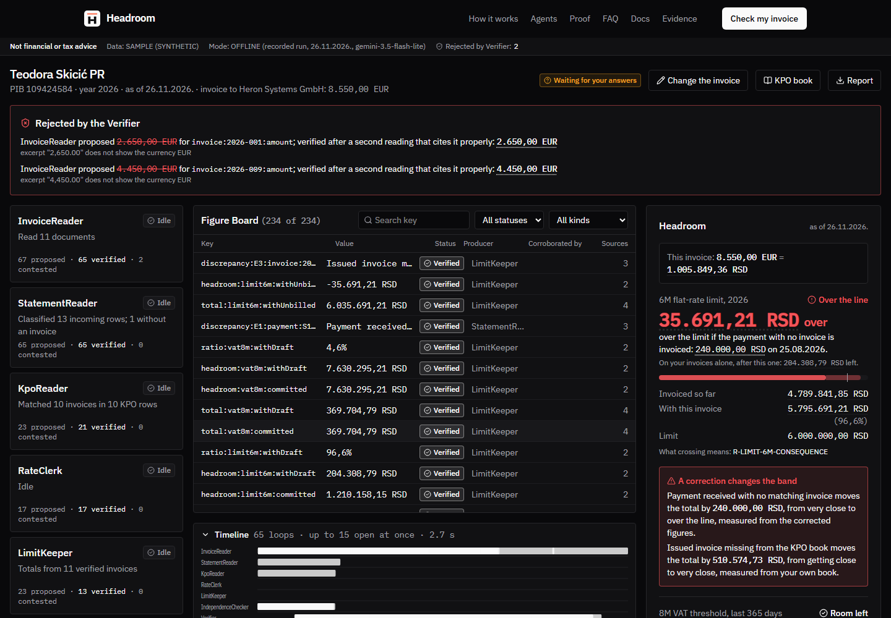

# Headroom

Before a Serbian paušalac sends an invoice, Headroom shows how much room is left under the 6M limit. Every number proven.

**Not financial or tax advice · Bundled samples are synthetic**

**Live demo:** https://headroom-umber.vercel.app (recorded sample only, no key, no uploads; the server sleeps when idle, so the first request can take up to a minute).

Built for the JigJoy Black Friday AI Hackathon (track: Agents in Finance) on Mozaik (`@mozaik-ai/core` 6.0.0).



The offline replay of `runs/demo-p07` (a real-model run): on the invoices alone there is room left, but a 240,000 RSD payment with no invoice would take the total over the 6M line, and the headline says so.

## Who it is for, and the moment

A Belgrade IT freelancer on paušal, with two or three clients (mostly foreign, invoiced in EUR) and one domestic client. It is late November, and they are about to invoice December's work for their biggest client.

They do not know whether this invoice pushes calendar-year turnover past 6,000,000 RSD once each foreign invoice is converted at the right NBS rate, whether a payment that landed in September without an invoice changes that answer, or whether the client's share of their income now meets criterion 6 of the independence test.

Headroom answers those three questions from their own bank statement, invoices and KPO book, before they press send, and shows the line each number came from.

## A team on Mozaik

Headroom is not an application that calls agents. A run is one Mozaik runtime that nine participants join; **nothing calls an agent**. Each one acts when an event satisfies one of its own `SituationSpecification`s, writes what it found to the shared state, and the others react. The user starts a run with a single event, and the readers all begin at once. There is no other runtime and no orchestrator: take `@mozaik-ai/core` out and no agent exists.

| Participant                                                     | Reacts when (its specifications, `src/agents/situations.ts`)                                                                                                     | Model                              |
| --------------------------------------------------------------- | ---------------------------------------------------------------------------------------------------------------------------------------------------------------- | ---------------------------------- |
| [InvoiceReader](src/agents/invoice-reader/agent.ts)             | the run starts; **one of its own figures is contested** (it reads the document again with the Verifier's note)                                                   | one loop per invoice               |
| [StatementReader](src/agents/statement-reader/agent.ts)         | the run starts; a payment, link or invoice figure is settled; one of its figures is contested; the InvoiceReader finishes (then it looks for unmatched payments) | one loop per 25 bank rows          |
| [KpoReader](src/agents/kpo-reader/agent.ts)                     | the run starts                                                                                                                                                   | one loop per 25 book rows          |
| [IndependenceChecker](src/agents/independence-checker/agent.ts) | the run starts; invoice figures change; one of its figures is contested; the user answers its question                                                           | one loop per client contract       |
| [Verifier](src/agents/verifier/agent.ts)                        | someone proposes a figure; two figures conflict; an input settles; the user answers its question                                                                 | one loop per judgement it re-reads |
| [RateClerk](src/agents/rate-clerk/agent.ts)                     | an invoice's amount, currency or date is verified; someone else claims an amount in RSD; a rate is needed                                                        | none: rules in code                |
| [LimitKeeper](src/agents/limit-keeper/agent.ts)                 | figures are verified or replaced; a reader finishes; the draft changes                                                                                           | none: rules in code                |
| [Human](src/agents/human.ts)                                    | the run starts (posts the invoice about to be sent); answers and changes come from the user                                                                      | the user                           |
| [Transcript](src/agents/observer.ts)                            | every event (the only participant that does)                                                                                                                     | none                               |

| Mozaik                               | What it does here                                                                                                                                                                                                                           | Where                                                                                  |
| ------------------------------------ | ------------------------------------------------------------------------------------------------------------------------------------------------------------------------------------------------------------------------------------------- | -------------------------------------------------------------------------------------- |
| `createAgent`, `createHuman`, `join` | every participant above; each model agent holds its prompt as its Mozaik instruction                                                                                                                                                        | `src/agents/*/agent.ts`                                                                |
| `SituationSpecification`, `.and()`   | all routing, for example `EventIs('hr.figure.contested').and(new AboutMyFigure())`                                                                                                                                                          | `src/agents/situations.ts`                                                             |
| `RuntimeState`                       | the Figure Board _is_ the runtime state every participant reads and writes                                                                                                                                                                  | [state.ts](src/runtime/state.ts)                                                       |
| `sendEvent`, `SemanticEvent`         | agents talk only through events: figure proposed, contested, verified, questions, rate needed                                                                                                                                               | [runtime.ts](src/runtime/mozaik/runtime.ts)                                            |
| `runLoop`                            | every model request, with a fresh `ModelContext`; an agent hears its answer through its own specification on `model.answer`                                                                                                                 | [runtime.ts](src/runtime/mozaik/runtime.ts)                                            |
| `InterceptionHandler`                | the Verifier sits inside the four reading agents' loops and refuses a submission that reports a value without the text it was read from, before the tool runs. A test makes it fire; in the recorded and live runs so far no model did this | [gate.ts](src/agents/verifier/gate.ts)                                                 |
| custom `InferenceRunner`             | timeouts, retries, rate-limit pacing, recording and replay                                                                                                                                                                                  | [runtime.ts](src/runtime/mozaik/runtime.ts), [recordings.ts](src/engine/recordings.ts) |

Mozaik calls a processor without awaiting it, so each participant's processor puts the event in that participant's own [queue](src/runtime/inbox.ts): one agent handles one event at a time, different agents run side by side. `runLoop` reports no failure of its own, so a failed request is turned into a failed loop, which makes the run `degraded` or `failed`. A [test](test/engine/mozaik.e2e.test.ts) fails if an agent stops being a participant with specifications of its own.

Found in Mozaik while building this and reported upstream with a reproduction: its Gemini mapper drops `thoughtSignature`, so the request after a tool call fails ([jigjoy-ai/mozaik-network#160](https://github.com/jigjoy-ai/mozaik-network/issues/160); workaround in [gemini-signatures.ts](src/runtime/mozaik/gemini-signatures.ts)).

**Checks between agents.** Readers claim the same keys: the InvoiceReader and the KpoReader both state an invoice's date and RSD amount, and the RateClerk re-derives the amount from the NBS rate. Agreement corroborates; disagreement is a conflict that the Verifier settles by checking both against their sources and, if both hold, by source authority (invoice document over KPO row for invoice facts, statement row over document for payment facts). The losing figure becomes the discrepancy the user sees.

## Use it on your own files

```
git clone https://github.com/TheWeirdDee/headroom.git && cd headroom
npm run setup
cp .env.example .env         # add your Gemini key (GEMINI_API_KEY, free at aistudio.google.com)
npm start                    # open http://localhost:4317
```

Then drop in your bank statement CSV, invoice PDFs and KPO book, map the columns if asked, fill in the invoice you are about to send, and click **Check this invoice**. Requirements: Node 22 and a model key. The default model is Google's `gemini-3.5-flash-lite`, a small and fast model with a free tier; on 26 Nov 2026 the stronger `gemini-3.5-flash` kept answering "high demand" and `gemini-3.8-flash` allows 20 requests a day on the free tier, while a run needs about 85. Requests are paced (10 a minute by default, `HEADROOM_MAX_RPM`) so the free quota slows a run down instead of failing it. Claude, GPT and DeepSeek models work too (set `HEADROOM_MODEL_READER` / `HEADROOM_MODEL_VERIFIER` and that provider's key), and so do Groq models, written `groq/<model>` with `GROQ_API_KEY` (Mozaik 6.0.0 has no Groq provider; `src/runtime/mozaik/groq.ts` points Mozaik's OpenAI chat-completions endpoint at Groq's OpenAI-compatible API). Live mode and uploads run only on your own computer. CI runs the tests on Linux and Windows; macOS is not tested.

## Try it without your files or a key

The [live demo](https://headroom-umber.vercel.app) is a hosted read-only copy of the same offline mode (`render.yaml`, `npm run start:public`): no model key on the server, uploads refused, a band on every page saying so, and recorded runs that finish in seconds.

```
npm run start:offline        # bundled sample, recorded model outputs, no key, no network
```

Or click **Try with sample data** (or **Catch a wrong number**) on the landing page. Offline mode is real Mozaik execution with recorded model outputs, not a video. If a recorded run asks for anything that was not recorded, it stops with `REPLAY_MISS` instead of inventing an answer. A replay answers each request after a short fixed pause, so it finishes in seconds; `npm run start:offline -- --speed 4` instead replays the recorded model latencies four times faster.

The recording in `runs/demo-p07` was made on 26 Nov 2026 with `gemini-3.5-flash-lite` as both reader and verifier model, on Mozaik 6.0.0 (`runs/demo-p07/meta.json`, `summary.json`). In that run: 65 loops, none failed; 83 model requests; 215 figures verified and 0 shown without a source; 2 conflicts between two agents (the KpoReader against the InvoiceReader, and against the RateClerk), both settled by the source document (the run summary says 23: the other 21 were the LimitKeeper and IndependenceChecker revising their own figures, which the claims helper then logged as conflicts; it now treats an agent's own revision as a revision); all five errors planted in the sample (E1, E2, E3, E5, E9) found; the 6M and 8M totals equal to the sample's ground truth. Two figures were contested by code checks (an invoice amount cited without its currency) and verified after the reader read the invoice again. Replaying it ten times in a row gives the same board each time (figures, values, sources, findings and card; ids and timestamps aside). All live results in this README come from that lite model; a stronger model may read better.

It took three recordings. The first missed E1: the Verifier's model rejected correct judgements as too literal ("Uplata za konsultacije", a payment for consultations, was not accepted as a client payment; "Nemačka" was not accepted as Germany), and a reader did not re-read a contested row, so the payment never reached the E1 check. The second found all five but left one contract criterion contested for the same reason. The fixes (the Verifier gets the same category meanings as the reader; every reader re-reads a contested figure at most twice, then the question goes to you) are in the git history next to the recordings.

## What you will see

1. The landing page: the 6M limit, unchanged since 2013 (cited), what crossing it means (cited), and two buttons.
2. Intake: your files, a column mapper for CSV layouts it does not recognise, your clients and the draft invoice.
3. Seven agent lanes start at once, each with a plain "doing now" line. What the Verifier rejects is listed above them.
4. Figures appear on the board as proposed, then turn verified, contested or needs-you as the Verifier checks each against its source.
5. Conflicts are visible: the KPO book says one date or amount, the invoice says another, and the source decides.
6. The headroom card says **Incomplete**, with the reasons, until every input is verified; a failed agent loop keeps it that way and ends the run `degraded` or `failed`. Then it gives the verdict, counting client payments that have no invoice, and says which discrepancy moves the band.
7. Discrepancies and questions collect below the board. Answering a question re-opens the run and the dependent agents recompute.
8. The KPO book tab shows the corrected book in the official layout with a correction log, exportable as CSV or PDF.
9. The Evidence tab shows the evaluation results, misses included.

## Your data

- Uploaded files stay on your machine, in `uploads/<id>/`. **Delete my files** on the intake page removes them.
- In live mode, the extracted text of your invoices, statement rows and KPO rows is sent to the model provider (Google Gemini by default) to be read. Nothing else leaves the machine: arithmetic, rules and totals run locally.
- NBS middle rates come from the public Kurs API (`kurs.resenje.org`); only currency and date are sent.
- Runs on your files are never recorded. Only bundled synthetic samples can be recorded for offline replay.

## Proof it is concurrent

```
npm run prove               # no key, no network
npm run prove -- --live     # the same measurement on provider requests (uses your quota)
```

The command runs the `p07` sample on Mozaik and records, for every model request, the moment it is sent (after any wait for a rate limit) and the moment it is answered. It prints when each agent was waiting on a model, and **exits 1** unless at least three different agents and four requests were outstanding at the same instant with no failed loop. CI runs it on every push. Without a key the answers come from the recording after a short pause, so it proves that Mozaik runs the agents' loops side by side without blocking; `--live` measures the provider.

One run without a key, on 27 Nov 2026 (times differ a little from run to run):

```
  independence-checker 3333335333331...............................................  6 requests
  kpo-reader           1111112111111...............................................  2 requests
  statement-reader     11111111111111..............................................  2 requests
  invoice-reader       444444445644446644445544446533335433444211111111211111111111  26 requests
  verifier             .....366666+66666+666668966667+6666697666786977797764441....  47 requests

Peak requests outstanding at once   15
Peak agents waiting on a model      5 (independence-checker, invoice-reader, kpo-reader, statement-reader, verifier)
Time with 2+ agents waiting at once 2.53 s of 2.74 s with any request
Sum of request times                23.15 s (one after another would take this long)
PASS: the agents asked their models at the same time.
```

The run screen draws every loop as a bar on a timeline. A loop there is open from its start to its answer, which on a free tier includes waiting for the quota, so "loops open at once" is not the same as requests in flight; use `npm run prove` for the latter.

## Watch the Verifier catch a wrong number

```
npm run demo:catch          # or the "Catch a wrong number" button on the landing page
```

This replays the recorded sample with **one fault injected on purpose**: the first reading of invoice 2026-006 is altered from 3500.00 to 5300.00 EUR before it reaches the InvoiceReader. The model did not make that mistake, and every screen and report of such a run says so. What follows is the pipeline's own work:

```
invoice-reader proposed 5300 EUR -> CONTESTED: excerpt "3.500,00 EUR" does not show the amount 5300
invoice-reader proposed 3500 EUR -> VERIFIED
```

The Verifier rejects the figure, the InvoiceReader reads the document again with the Verifier's note (answered with what the model really answered), and the 6M total equals that of the replay without the fault (a test also checks it against the ground truth). The command exits 1 otherwise, and CI runs it. This particular catch is a code check: the cited line does not hold the number.

## Every number has a source

Every figure carries `SourceRef`s: a document page and line range with the excerpt and its SHA-256, a statement or KPO row with its raw line and hash, an NBS response with its hash and JSON path, a contract field, a rule, a user answer, or the input figures it was derived from. The Verifier checks each proposed figure before it counts. A failed check contests the figure with a reason code; after three contests on one key the question goes to you. Only verified figures reach the headroom card, the card gives no verdict until every input is verified, and the run report counts figures shown without a source (it must be 0).

Most of the checking is code. The Verifier's model is used only for judgements, and it sees the claimed value and the excerpt, never the reader's reasoning:

| What is checked                                                             | How   | What that check can catch                                                                                                      |
| --------------------------------------------------------------------------- | ----- | ------------------------------------------------------------------------------------------------------------------------------ |
| The source exists and its hash matches                                      | code  | invented or altered citations                                                                                                  |
| Invoice date, amount, currency, number, client against the cited text       | code  | a value the text does not show; a due or supply date given as the issue date; a unit price, subtotal or tax given as the total |
| Amounts, dates and names from bank and KPO rows                             | code  | consistency only: the same parser read the row                                                                                 |
| Conversions, totals, shares and statuses                                    | code  | any difference, to the cent, from recomputing them from the cited input figures                                                |
| NBS rate                                                                    | code  | a rate that differs from the recorded response                                                                                 |
| Client country, product or service, kind of bank payment, contract criteria | model | a judgement a second reading does not support                                                                                  |

The model never re-reads an amount or a date: those are checked by code against the text. A wrong value that the text also shows under no recognised label could pass.

## Results

`npm run eval` runs bundled profiles against their ground truth and writes `eval/results.json` and `eval/RESULTS.md` (the Evidence page shows them).

### With a real model: Gemini `gemini-3.5-flash-lite`

Measured 27 Nov 2026 with `gemini-3.5-flash-lite` as reader and verifier model (free tier), Mozaik 6.0.0, profile seed `headroom-2026-11-26`, **on 5 of our 14 synthetic profiles, 7 runs**: `c01` (clean) and `p07` (showcase) twice each, `p02`, `p05` and `p06` once. Together they contain every planted error type, E1 to E9. The other 9 profiles were not run with a real model: the free tier allows 500 requests a day for this model and a run needs about 85. Full table: `eval/RESULTS.md`; per-run files with the commit each ran on: `eval/raw/`.

| Metric (7 runs)                                      | Value                                                                |
| ---------------------------------------------------- | -------------------------------------------------------------------- |
| Planted errors found                                 | 19 / 19, all nine types (on 5 synthetic profiles we designed)        |
| Findings on the clean profile                        | 0 in 2 runs                                                          |
| Findings that were not planted                       | 0                                                                    |
| Verified invoice facts equal to the truth            | 222 / 222 (issue date, amount in RSD, kind)                          |
| Wrong figures that got verified                      | 0                                                                    |
| Figures shown without a source                       | 0                                                                    |
| Runs with 6M and 8M totals equal to the truth        | 7 / 7                                                                |
| Same headroom when a profile is run again            | 2 / 2 (only `c01` and `p07` were run twice)                          |
| Runs with a failed loop                              | 0 / 7                                                                |
| Planted book errors that surfaced as agent conflicts | 8 / 8 (E2, E4, E5, E7: KpoReader against InvoiceReader or RateClerk) |
| Verifier contests                                    | 5, all NOT_SUPPORTED_BY_SOURCE, each settled by a re-read            |
| Median loops open at once (peak) / loop ÷ wall time  | 15 / 10.73 (wall time is mostly the request pacer)                   |
| Median wall time / tokens per run                    | 482 s / 64,203 in, 6,934 out                                         |

The first runs of `c01` and `p07` were made before the claims fix of commit `64de262` (described below); the other five on commit `78f16f1`. The model did fall short before these runs: the first demo recording missed E1 (see "Try it without your files or a key"). Commits made after these runs changed the pipeline (the card gives a verdict only once every input is verified, E1 matches one payment to one invoice, the Verifier checks which field a value comes from, and the agents were rebuilt as Mozaik participants), and the runs above have not been repeated since. Seven runs on five profiles is a small sample; it shows the pipeline holding up with a small free model, not a measured accuracy.

### One live run of the current code

After the later changes, one run was made on 27 Nov 2026 at commit `0f1d044` with `gemini-3.5-flash-lite`, on the small synthetic profile of the test suite (3 invoices, 3 planted errors), because the day's free quota did not cover a full sample. All 3 planted errors were found and nothing else; 35 model requests, 27 loops, none failed; the card was complete; up to 10 requests and all 5 model agents were waiting on the model at the same time. Output: [eval/live-current/RESULTS.md](eval/live-current/RESULTS.md). It measures no accuracy.

### With a second real model: Groq `gpt-oss-120b` (partial, separate table)

Measured 27 Nov 2026 with `groq/openai/gpt-oss-120b` as reader and verifier model through Groq's free tier, **on 2 other synthetic profiles we designed, one run each**: `c02` (clean) and `p01` (3 planted errors). Groq's free tier allowed two runs that day (8,000 tokens a minute, about 200,000 a day; a run uses about 90,000). The next run, `p03`, hit the daily limit and was not counted. Results in `eval/groq-gpt-oss-120b/`.

| Metric (2 runs)                               | Value                                                                                                  |
| --------------------------------------------- | ------------------------------------------------------------------------------------------------------ |
| Planted errors found                          | 3 / 3 (E1, E3, E8 in `p01`)                                                                            |
| Verified invoice facts equal to the truth     | 60 / 60                                                                                                |
| Wrong figures that got verified               | 0                                                                                                      |
| Figures shown without a source                | 0                                                                                                      |
| Runs with 6M and 8M totals equal to the truth | 2 / 2                                                                                                  |
| Runs with a failed loop                       | 0 / 2                                                                                                  |
| **Findings that were not planted**            | **2: one E-CONFLICT on criterion 6 for client Linden, in each run (one of them on the clean profile)** |

The two false findings came from Headroom, not the model: the IndependenceChecker recomputed criterion 6 while its first value was still waiting for the Verifier (Groq's pacing makes that window long), and the claims helper treated the two versions as a conflict between equal sources. Fixed in commit `64de262` (an agent's new value for its own claim now supersedes it); these two runs were made before the fix.

### With the deterministic test model (all 14 profiles)

The table below is from **fake mode** (14 synthetic profiles we designed, two runs each, a deterministic test model, run on the current code with `npm run eval -- --mode fake --runs 2`). It measures the pipeline (rules, Verifier, conflicts, totals), not how well a real model reads documents.

| Metric                                                         | Value                                                                                           | Target | Note                                                                                      |
| -------------------------------------------------------------- | ----------------------------------------------------------------------------------------------- | ------ | ----------------------------------------------------------------------------------------- |
| Planted errors detected                                        | 80 / 80 (100.0%)                                                                                |        | on 14 synthetic profiles we designed                                                      |
| False discrepancies on clean profiles                          | 0 in 4 runs                                                                                     | 0      |                                                                                           |
| Findings that were not planted (all profiles)                  | 0                                                                                               |        |                                                                                           |
| Verified invoice facts equal to the truth                      | 918 / 918 (100.0%)                                                                              |        | issue date, amount in RSD and kind of every invoice                                       |
| Wrong figures that got verified                                | 0                                                                                               | 0      | the most important miss: listed below with figure ids                                     |
| Contested figures that were in fact wrong                      | 0 / 0                                                                                           |        |                                                                                           |
| Figures shown without a source                                 | 0                                                                                               | 0      |                                                                                           |
| Runs with 6M and 8M totals (with the draft) equal to the truth | 28 / 28                                                                                         |        |                                                                                           |
| Profiles with identical headroom across runs                   | 14 / 14                                                                                         |        | each profile ran twice                                                                    |
| Runs with a failed loop                                        | 0 / 28                                                                                          |        |                                                                                           |
| Median loops open at once (peak)                               | 15                                                                                              |        |                                                                                           |
| Median loop time / wall time                                   | 0.26                                                                                            |        | the test model answers instantly, so wall time is mostly the quiet period that ends a run |
| Median wall time per run                                       | 1.9 s                                                                                           |        |                                                                                           |
| Median tokens per run (in / out)                               | 19000 / 4582                                                                                    |        |                                                                                           |
| Verifier contests by reason (all runs)                         | UNSOURCED 0, SOURCE_MISMATCH 0, DERIVATION_MISMATCH 0, NOT_SUPPORTED_BY_SOURCE 0, IMPLAUSIBLE 0 |        |                                                                                           |
| Planted book errors that surfaced as real agent conflicts      | 34 / 34                                                                                         |        | E2, E4, E5, E7: KpoReader against InvoiceReader or RateClerk                              |
| Messy CSV layouts parsed without errors                        | 7 / 7                                                                                           |        | 02-windows-1250.csv: account currency asked from the user                                 |

| Type | Planted | Found | Missed | Extra |
| ---- | ------- | ----- | ------ | ----- |
| E1   | 10      | 10    | 0      | 0     |
| E2   | 8       | 8     | 0      | 0     |
| E3   | 10      | 10    | 0      | 0     |
| E4   | 8       | 8     | 0      | 0     |
| E5   | 10      | 10    | 0      | 0     |
| E6   | 8       | 8     | 0      | 0     |
| E7   | 8       | 8     | 0      | 0     |
| E8   | 8       | 8     | 0      | 0     |
| E9   | 10      | 10    | 0      | 0     |

## Architecture

```
Browser (React + Vite): landing, intake + column mapper, run screen, KPO, evidence
        |  REST + SSE (/api/runs/:id/stream, Last-Event-ID resume)
Node 22 backend (Fastify)
  Run engine: one Mozaik runtime per run
    Participants (src/agents/): InvoiceReader, StatementReader, KpoReader, RateClerk,
            LimitKeeper, IndependenceChecker, Verifier, Human, Transcript
    RuntimeState: the Figure Board (src/runtime/state.ts) + claims helper (packages/claims)
    Loops, events and the InferenceRunner (src/runtime/mozaik/)
    Rules engine (pure TypeScript, rules/*.json, exact decimals)
    Recorder / replayer, quiescence detector
  Exporters: KPO CSV and PDF, correction log, run report JSON
        |                                     |
  Model provider (via Mozaik)        Kurs API (NBS middle rates)
```

- **InvoiceReader** reads invoice PDFs and proposes number, dates, amount, currency, client and kind, each with its line excerpt.
- **StatementReader** classifies incoming statement rows and links payments to invoices.
- **KpoReader** reads the user's KPO book and claims each row against the invoices.
- **RateClerk** fetches the NBS middle rate for each foreign invoice date and converts to RSD.
- **LimitKeeper** totals verified turnover for the 6M limit and the 8M VAT window, with and without the draft, and explains band crossings.
- **IndependenceChecker** evaluates the nine criteria per client, including the income share of criterion 6.
- **Verifier** checks every figure against its source before it counts.

The event types are defined in `src/events/schemas.ts`.

## Tax rules used

| Rule                         | Statement                                                                                                                                                                                                                                                                                                                                                                                                   | Source                                                                                                                                                                                                                            | Status              |
| ---------------------------- | ----------------------------------------------------------------------------------------------------------------------------------------------------------------------------------------------------------------------------------------------------------------------------------------------------------------------------------------------------------------------------------------------------------- | --------------------------------------------------------------------------------------------------------------------------------------------------------------------------------------------------------------------------------- | ------------------- |
| `R-FX`                       | For bookkeeping, the official NBS middle rate of the dinar applies.                                                                                                                                                                                                                                                                                                                                         | [Zakon o deviznom poslovanju](https://www.paragraf.rs/propisi/zakon_o_deviznom_poslovanju.html)                                                                                                                                   | Sourced             |
| `R-FX-DATE`                  | A foreign-currency invoice is converted at the NBS middle rate on its issue date.                                                                                                                                                                                                                                                                                                                           | [Unija: KPO knjiga](https://unija.com/sr/kpo-knjiga/)                                                                                                                                                                             | Assumption [VERIFY] |
| `R-FX-NONPUB`                | On weekends and holidays, when NBS publishes no new rate, the most recent published rate is used. Both the requested date and the rate date are shown.                                                                                                                                                                                                                                                      | [Kurs API documentation](https://kurs.resenje.org/doc/)                                                                                                                                                                           | Assumption [VERIFY] |
| `R-FX-ROUNDING`              | The RSD amount is rounded to two decimals, half up.                                                                                                                                                                                                                                                                                                                                                         | [Zakon o deviznom poslovanju](https://www.paragraf.rs/propisi/zakon_o_deviznom_poslovanju.html)                                                                                                                                   | Assumption [VERIFY] |
| `R-INDEP`                    | Income from a client is treated as "other income" instead of self-employment income if, for that client, at least five of the nine criteria are met (or it could be concluded at the start of the work that five would be met and they later were). Evaluated per client.                                                                                                                                   | [Zakon o porezu na dohodak građana](https://www.paragraf.rs/propisi/zakon_o_porezu_na_dohodak_gradjana.html)                                                                                                                      | Sourced             |
| `R-INDEP-EXEMPT`             | The test does not apply to an entrepreneur who, under the law governing their activity, cannot be employed by the client (for example a lawyer).                                                                                                                                                                                                                                                            | [Zakon o porezu na dohodak građana](https://www.paragraf.rs/propisi/zakon_o_porezu_na_dohodak_gradjana.html)                                                                                                                      | Sourced             |
| `R-INDEP-C6-WINDOWS`         | Every 12-calendar-month period that starts or ends in the tax year is checked; the card shows the highest share and its period.                                                                                                                                                                                                                                                                             | [Zakon o porezu na dohodak građana](https://www.paragraf.rs/propisi/zakon_o_porezu_na_dohodak_gradjana.html)                                                                                                                      | Sourced             |
| `R-INDEP-C6-HORIZON`         | Headroom evaluates the 12-month periods that have ended by the month being checked (the as-of month, or the draft invoice month for the with-draft share) and that your files cover, plus always the 12 months up to that month. A period reaching into the future, or mostly before your files start, holds only part of its income, so its share would mislead. Another period may still reach 70% later. | [Zakon o porezu na dohodak građana](https://www.paragraf.rs/propisi/zakon_o_porezu_na_dohodak_gradjana.html)                                                                                                                      | Headroom convention |
| `R-INDEP-C6-BASIS`           | Income is counted from issued invoices in RSD by issue date. The law says "ostvarenih prihoda" (income earned) and does not say invoiced or received.                                                                                                                                                                                                                                                       | [Zakon o porezu na dohodak građana](https://www.paragraf.rs/propisi/zakon_o_porezu_na_dohodak_gradjana.html)                                                                                                                      | Assumption [VERIFY] |
| `R-INDEP-CONSEQUENCE`        | Income from that client may be taxed as other income: 20% tax plus 25.5% pension and disability (PIO) contributions, with no standardised expenses deducted. Headroom does not calculate any amount.                                                                                                                                                                                                        | [Biznis.rs](https://biznis.rs/preduzetnik/preduzetnici-na-proveri-poslovne-samostalnosti/)                                                                                                                                        | Sourced             |
| `R-INDEP-WHO-FILES`          | Check who files and pays. Not confirmed for foreign clients.                                                                                                                                                                                                                                                                                                                                                | [Poreska uprava: Tax bulletins for natural persons who are self-employed](https://www.purs.gov.rs/upload/media/2025/6/30/759981/Tax_bulletins_for_natural_persons_who_are_self_-_employed.pdf)                                    | Assumption [VERIFY] |
| `R-KPO`                      | A paušal entrepreneur keeps only the KPO book, recording income from products sold and services provided; every issued invoice is entered, paid or not.                                                                                                                                                                                                                                                     | [Zakon o porezu na dohodak građana](https://www.paragraf.rs/propisi/zakon_o_porezu_na_dohodak_gradjana.html)                                                                                                                      | Sourced             |
| `R-KPO-LAYOUT`               | Columns: 1 row number; 2 date and description; 3 income from products; 4 income from services; 5 total (3 + 4). Header: PIB, taxpayer name, business name, address, taxpayer code, activity code.                                                                                                                                                                                                           | [Pravilnik o poslovnim knjigama i iskazivanju finansijskog rezultata po sistemu prostog knjigovodstva](https://www.paragraf.rs/propisi/pravilnik-o-poslovnim-knjigama-finansijski-rezultat-po-sistemu-prostog-knjigovodstva.html) | Sourced             |
| `R-KPO-DATE`                 | Column 2 takes the invoice issue date and number.                                                                                                                                                                                                                                                                                                                                                           | [Pravilnik o poslovnim knjigama i iskazivanju finansijskog rezultata po sistemu prostog knjigovodstva](https://www.paragraf.rs/propisi/pravilnik-o-poslovnim-knjigama-finansijski-rezultat-po-sistemu-prostog-knjigovodstva.html) | Assumption [VERIFY] |
| `R-PAYMENT-NO-INVOICE`       | A payment was received with no matching invoice. Headroom states only the fact and its statement row; no legal obligation or deadline is claimed.                                                                                                                                                                                                                                                           | [Zakon o porezu na dohodak građana](https://www.paragraf.rs/propisi/zakon_o_porezu_na_dohodak_gradjana.html)                                                                                                                      | Assumption [VERIFY] |
| `R-NUMBERING`                | A gap in invoice numbering is shown as worth checking, not as an error.                                                                                                                                                                                                                                                                                                                                     | [Pravilnik o poslovnim knjigama i iskazivanju finansijskog rezultata po sistemu prostog knjigovodstva](https://www.paragraf.rs/propisi/pravilnik-o-poslovnim-knjigama-finansijski-rezultat-po-sistemu-prostog-knjigovodstva.html) | Assumption [VERIFY] |
| `R-LIMIT-6M`                 | Flat-rate taxation is not granted to a taxpayer whose total turnover in the year before the tax year (or planned turnover when starting) is above 6,000,000 dinars. When the limit is crossed during a year, the tax office orders business books from mid-year or from the next year (Art. 42). Headroom sums the calendar-year turnover of issued invoices against this limit.                            | [Zakon o porezu na dohodak građana](https://www.paragraf.rs/propisi/zakon_o_porezu_na_dohodak_gradjana.html)                                                                                                                      | Sourced             |
| `R-LIMIT-6M-BASIS`           | Turnover is counted by invoice issue date within the calendar year, summed across all activities. A payment received without an invoice is shown as a discrepancy, not as turnover.                                                                                                                                                                                                                         | [Zakon o porezu na dohodak građana](https://www.paragraf.rs/propisi/zakon_o_porezu_na_dohodak_gradjana.html)                                                                                                                      | Assumption [VERIFY] |
| `R-LIMIT-6M-CONSEQUENCE`     | Crossing 6M means keeping full business books: from 1 July if crossed in the first half of the year, otherwise from 1 January of the next year.                                                                                                                                                                                                                                                             | [Biznis.rs](https://biznis.rs/vesti/srbija/limit-od-sest-miliona-dinara-koci-razvoj-preduzetnika/)                                                                                                                                | Sourced             |
| `R-LIMIT-6M-INDEP-EXCLUSION` | Income taxed as other income after a failed independence test is not counted in the 6M turnover. Headroom does not apply this automatically; it notes it when a client shows "fails".                                                                                                                                                                                                                       | [Zakon o porezu na dohodak građana](https://www.paragraf.rs/propisi/zakon_o_porezu_na_dohodak_gradjana.html)                                                                                                                      | Sourced             |
| `R-LIMIT-BANDS`              | Green below 80%, amber from 80% to below 90%, red from 90% to below 100%, crossed at 100% or more. The 90% line mirrors the Minimax warning.                                                                                                                                                                                                                                                                | [Minimax help: Upozorenje za ulazak paušalaca u knjigaše ili za ulazak u sistem PDV-a](https://rs-minimax.knowledgeowl.com/help/upozorenje-za-ulazak-pausalaca-u-knjigase-ili-za-ulazak-u-sistem-pdv-a)                           | Headroom convention |
| `R-VAT-8M`                   | A small taxpayer is one whose total turnover of goods and services in the previous 12 months is not above 8,000,000 dinars. "Previous 12 months" is 365 days (366 in a leap period) ending on the day of the turnover.                                                                                                                                                                                      | [Zakon o porezu na dodatu vrednost](https://www.paragraf.rs/propisi/zakon_o_porezu_na_dodatu_vrednost.html)                                                                                                                       | Sourced             |
| `R-VAT-8M-SCOPE`             | Counted: all goods, including goods exported abroad (exempt with the right to deduction), services to clients in Serbia, and services to foreign clients that are not businesses. Not counted: services to foreign business clients, because they are supplied where the client has its seat.                                                                                                               | [Zakon o porezu na dodatu vrednost](https://www.paragraf.rs/propisi/zakon_o_porezu_na_dodatu_vrednost.html)                                                                                                                       | Sourced             |
| `R-VAT-8M-REGISTRATION`      | A taxpayer whose turnover in the previous 12 months goes above 8,000,000 dinars must file a VAT registration (evidenciona prijava) within five days of the day that turnover was reached.                                                                                                                                                                                                                   | [Zakon o porezu na dodatu vrednost](https://www.paragraf.rs/propisi/zakon_o_porezu_na_dodatu_vrednost.html)                                                                                                                       | Sourced             |
| `R-VAT-8M-BASIS`             | Turnover is placed in the window by invoice issue date.                                                                                                                                                                                                                                                                                                                                                     | [Minimax help: Upozorenje za ulazak paušalaca u knjigaše ili za ulazak u sistem PDV-a](https://rs-minimax.knowledgeowl.com/help/upozorenje-za-ulazak-pausalaca-u-knjigase-ili-za-ulazak-u-sistem-pdv-a)                           | Assumption [VERIFY] |

Rules marked **Assumption [VERIFY]** are not confirmed by an official source and appear as assumption chips wherever they affect a number.

## Limitations

Headroom runs on synthetic data and a rules table we sourced from public Serbian guidance; rules marked as assumptions still need an accountant's confirmation, and it does not calculate tax owed.

- No OCR: scanned PDFs without a text layer are listed as unreadable.
- The column mapper supports no bank by name; unknown layouts are mapped by hand.
- Only the products and services split of the KPO book; no credit notes or advances.
- No SEF e-invoicing integration.
- Special VAT place-of-supply cases are not modelled.

## packages/claims

A small synchronous claims store: agents propose a value for a key with sources; the store answers claimed, corroborated, conflict, stale or duplicate, keeps one verified record per key, and delivers change events after each mutation. It has no Headroom or Mozaik dependency. See `packages/claims/README.md`.

## Development

```
npm run dev          # API with reload on :4317 and Vite on :5173
npm test             # unit and integration tests (deterministic test model)
npm run prove        # measures overlapping model requests; exits 1 if the agents did not overlap
npx playwright install chromium   # once, before the first end-to-end run
npm run test:e2e     # Playwright against the real server
npm run lint && npm run typecheck
npm run eval -- --mode fake
```

## Credits and licence

MIT. See `LICENSE`. Inter font under the SIL Open Font License (`assets/fonts/OFL.txt`). NBS rates via the Kurs API by resenje.org. Built on Mozaik by JigJoy.
